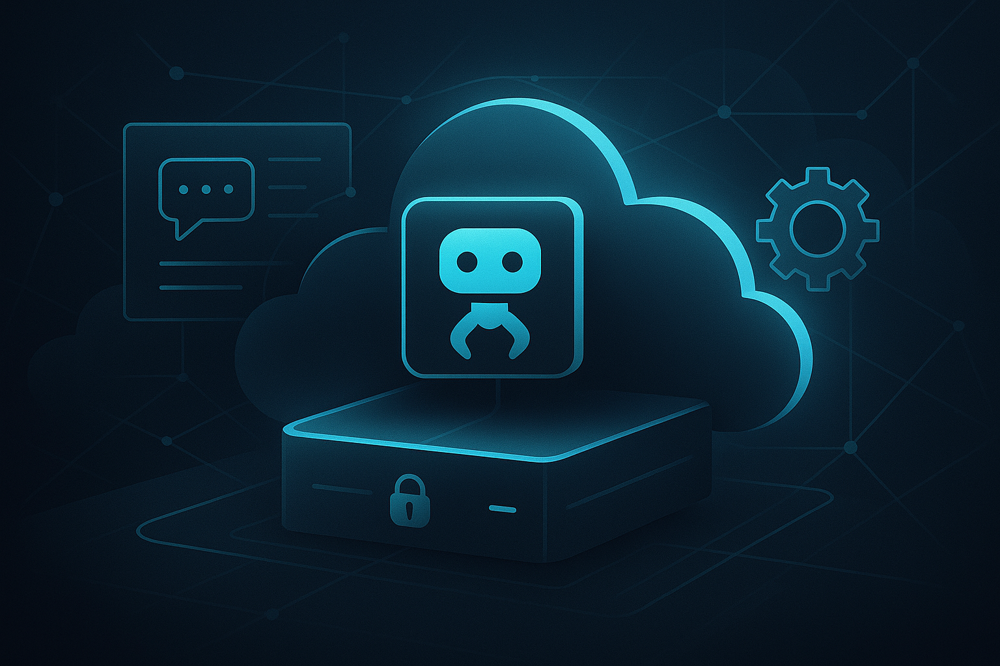

{: style="border-radius: 20px;"}

# OpenClaw
OpenClaw is an open-source AI assistant framework that runs on infrastructure you control. Instead of depending on a hosted AI agent service, you can deploy it on a small VPS and keep your models, tools, and data flow closer to your own environment.

In this post, I will focus on a practical question: why run OpenClaw on a cloud node, and what does a minimal secure setup look like on a low-cost VPS such as Hetzner or AWS Lightsail?

## Why run it on a cloud node?

Running OpenClaw on a VPS is useful if you want:
- **Always-on availability**: Your assistant stays online even when your laptop is closed.
- **Stable network reachability**: Easier remote access, webhooks, and gateway access than on a home network.
- **Separation from your daily machine**: Agent tooling, logs, and automations live on a dedicated host.
- **Predictable cost**: A small instance is often enough for a personal agent, especially if inference happens through external model APIs.

## What is OpenClaw?

OpenClaw is a personal AI agent platform built for developers and power users. Key traits:
- **Self-hosted**: Runs on your hardware (laptop, server, Raspberry Pi, or cloud node).
- **Messaging integrations**: Can connect to services like WhatsApp, Telegram, Discord, Slack, and others through its gateway and integrations.
- **Agentic**: Supports subagents, tools (file ops, shell exec, web search), skills (plugins for GitHub, calendars, etc.), and persistent memory.
- **Model-agnostic**: Works with hosted and local models, depending on your provider setup.
- **Open-source**: [GitHub repo](https://github.com/openclaw/openclaw) with a large and active community.

It's not just a chatbot; it's an extensible system for automation, with heartbeats for proactivity, cron jobs, and community skills.

## What Can It Do?

OpenClaw shines in real-world automation:
- **Task automation**: Clear inboxes, manage calendars (gcalcli), send emails, check flights.
- **Development workflows**: GitHub issues/PRs (skills like gh-issues), code review, CI monitoring.
- **Research & content**: Web search, image gen/analysis, note-taking (Obsidian publish).
- **System ops**: Shell access (safe exec), file management, tmux control.
- **Proactive**: Heartbeats check emails/calendar/weather; subagents for parallel tasks.
- **Voice/media**: TTS, image handling, voice notes transcription.

Examples: "Ship checklist" can become an automated deployment checklist, or you can spawn subagents for parallel work across multiple repos.

## Security Considerations

Self-hosting improves control, but it also means you own the operational risk:
- **Minimal exposure**: Prefer loopback-only binding plus Tailscale or another private access layer instead of opening the gateway publicly.
- **Secrets handling**: Store API keys carefully and keep them out of shell history, screenshots, and public dotfiles.
- **Exec safety**: Treat shell and file tools as privileged capabilities. Keep approval requirements in place for destructive or elevated commands.
- **Firewalling**: Allow only what you need, ideally SSH and your private networking layer.
- **Updates**: Stay current with OpenClaw and its runtime requirements.
- **Isolation**: Run as a non-root user and keep the workspace scoped to what the agent actually needs.
- **Plugin hygiene**: Review skills and plugins before enabling them on a machine with real data.

The main risks are straightforward: prompt injection, accidental over-permissioning, and exposing an interface to the public internet without enough access control.

## Practical Setup on Hetzner or AWS Lightsail

1. **Provision node**:
   - Hetzner: a small shared vCPU instance with Ubuntu 24.04 is enough to start.
   - Lightsail: a small Ubuntu instance is also fine for a personal deployment.
   - Create a non-root user and use SSH keys.

2. **Secure basics**:
   ```
   sudo apt update && sudo apt upgrade -y
   sudo apt install ufw curl -y
   sudo ufw default deny incoming
   sudo ufw allow ssh
   sudo ufw --force enable
   # Disable root SSH, password auth in /etc/ssh/sshd_config
   sudo systemctl restart ssh
   ```

3. **Install Node & OpenClaw**:
   ```
   curl -fsSL https://openclaw.ai/install.sh | bash
   openclaw onboard --install-daemon
   ```
   OpenClaw currently recommends Node 24, with Node 22.16+ also supported if you are installing through npm instead of the installer script.

4. **Configure & pair**:
   - Pair the channels you actually use, such as WhatsApp or Telegram.
   - Set your model provider and workspace during onboarding.
   - Test: `openclaw agent --message "Hello from cloud!"`.

5. **Remote access** (optional):
   - Tailscale is a good fit if you want private remote access without exposing the gateway directly to the internet.
   - Keep the gateway bound to loopback where possible and let Tailscale handle access.

6. **Monitor**: `openclaw doctor`, `journalctl -u openclaw` (systemd).

At that point you have an always-on OpenClaw node with a cleaner separation between your assistant runtime and your personal machine.
